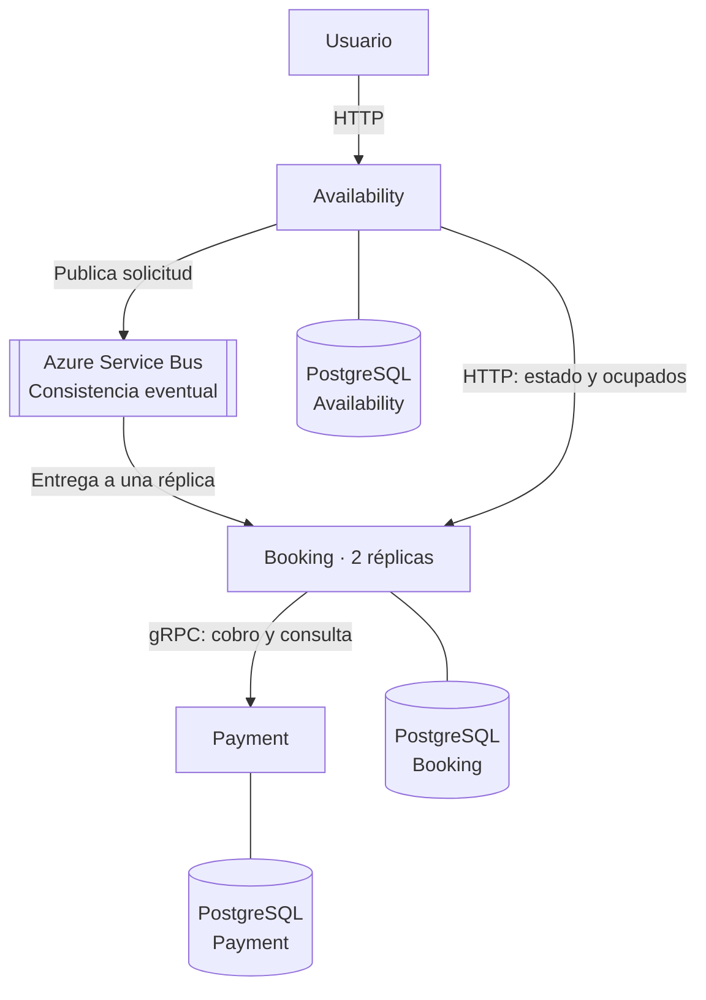
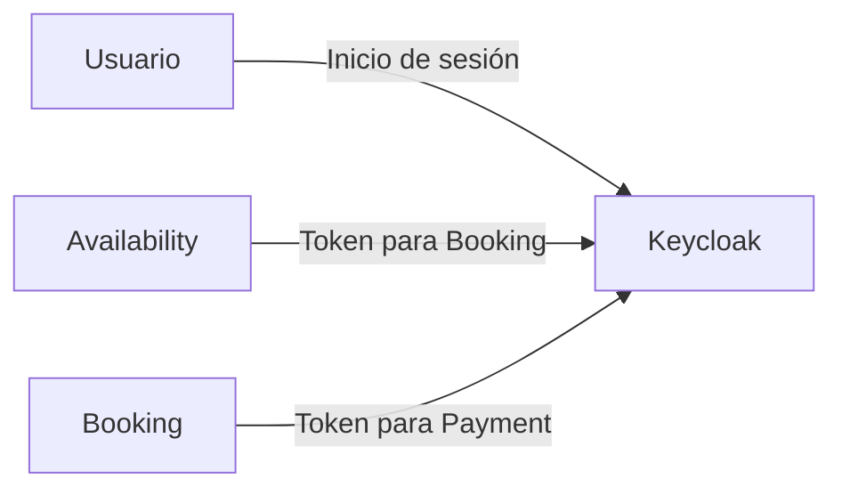
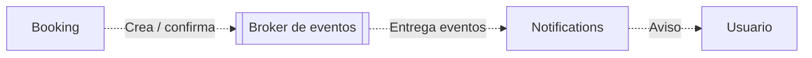

# Arquitectura general del sistema de reserva de asientos

El sistema utiliza una arquitectura de microservicios. Availability recibe las solicitudes del usuario, Booking administra las reservas y Payment procesa el cobro simulado.

Esta vista general complementa los diagramas específicos de cada API. Las comunicaciones implementadas y la integración propuesta de Notifications se muestran por separado para distinguir su alcance.

## 1. Servicios y datos

Las flechas representan comunicaciones. Las líneas sin punta conectan cada servicio con su propia base de datos; ningún servicio consulta directamente la base de otro.

Availability publica `ReservationRequestedMessage` en el topic `grupo5-booking-topic`. Las réplicas de Booking consumen desde la suscripción `booking`. Para las consultas de estado y asientos ocupados, Availability utiliza la API HTTP de Booking. Booking solicita el cobro a Payment mediante `Charge` y puede consultar una operación existente mediante `GetPayment`.

### Consistencia eventual

La ventana principal aparece en el recorrido **Availability → Azure Service Bus → Booking**, señalado en el diagrama.

Availability registra y publica la solicitud antes de responder `202 Accepted` con su `requestId`. Esa respuesta no espera a que Booking procese el mensaje ni garantiza el asiento.

Durante ese intervalo:

- Availability conoce la solicitud, pero Booking puede no tener todavía una reserva asociada.
- Para una solicitud publicada, Availability muestra `PENDING` mientras Booking responde `404` porque aún no existe una reserva para ese `requestId`.
- Un asiento mostrado como disponible puede ocuparse antes de que se procese otra solicitud.

`PENDING` pertenece al seguimiento de la solicitud; no es un estado adicional de la reserva. Un error de conexión con Booking no se interpreta como una reserva inexistente ni se convierte en `PENDING`.

### Reentregas, idempotencia y concurrencia

Las dos réplicas de Booking compiten por las entregas de la misma suscripción. Una entrega se asigna a una réplica, pero un mensaje puede volver a entregarse, por ejemplo, si se pierde su confirmación después del procesamiento. No se garantiza un procesamiento exactamente una vez.

Booking utiliza el `requestId` para reconocer solicitudes repetidas. PostgreSQL mantiene un índice único por solicitud y una restricción única para el asiento de un evento mientras exista una reserva retenida o confirmada. Esto evita reservas duplicadas y dos reservas activas para el mismo asiento.

Los reintentos del cobro conservan `Reservation.Id` como `PaymentOperationId`. Payment utiliza ese identificador para reconocer la misma operación lógica y evitar duplicar el pago. Los `UPDATE` condicionales de Booking controlan las transiciones que pueden competir, como la confirmación y el vencimiento.

## 2. Autenticación

Las flechas indican quién inicia la autenticación o solicita un token a Keycloak. Availability y Booking obtienen sus tokens de servicio mediante `client_credentials` y los envían como Bearer JWT al realizar la llamada correspondiente.

La emisión del token y su validación son tareas distintas:

| Comunicación | Quién valida el token | Audiencia esperada |
|---|---|---|
| Usuario → Availability, para reservar y consultar sus solicitudes | Availability | `availability` |
| Availability → Booking | Booking | `booking` |
| Booking → Payment | Payment | `payment` |

Keycloak emite y firma los tokens. Cada API receptora valida la firma, el emisor, la audiencia y la vigencia del JWT usando la configuración y las claves públicas publicadas por Keycloak. La validación se realiza en la API; no requiere pedir una autorización a Keycloak por cada petición. Booking y Payment también comprueban que el cliente de servicio esté autorizado.

Las consultas públicas de eventos y asientos no requieren un token del usuario. Cuando Availability consulta internamente los asientos ocupados en Booking, utiliza su propio token de servicio.

La conexión con Azure Service Bus utiliza su connection string configurada para el entorno. No utiliza los tokens de Keycloak representados en este diagrama.

## 3. Integración propuesta de Notifications

**Las flechas discontinuas representan una propuesta de integración, no un circuito implementado.**

Booking publicaría los siguientes eventos después de persistir el cambio correspondiente:

| Evento | Momento | Aviso al usuario |
|---|---|---|
| `ReservationCreated` | Después de crear una reserva retenida. | La reserva fue creada y espera el resultado del pago. |
| `ReservationConfirmed` | Después de confirmar la reserva por un pago exitoso. | La reserva quedó confirmada. |

Notifications consumiría esos eventos y enviaría el aviso por el canal definido, por ejemplo, correo electrónico. De esta forma, una demora del envío no bloquearía el procesamiento de la reserva.

Los eventos deberían identificar la reserva, el usuario y la solicitud original. Notifications debería evitar avisos duplicados ante reentregas. El canal de eventos, la suscripción, los permisos, los datos de contacto y el mecanismo de envío se definirían al implementar este circuito.

### Estado actual

Booking dispone de `IReservationEventPublisher` y lo invoca con `ReservationCreated` y `ReservationConfirmed`. Su implementación actual, `LoggingReservationEventPublisher`, únicamente registra esos eventos en logs.

El worker de Notifications todavía no consume eventos ni envía avisos. El broker de este diagrama representa el canal propuesto para notificaciones; no implica que ya exista una suscripción configurada ni que se utilice la suscripción `booking` de solicitudes de reserva.

## 4. Flujo de una reserva

1. El usuario consulta eventos y asientos en Availability.
2. Para reservar, obtiene un token de Keycloak y envía el evento y el asiento.
3. Availability verifica que el asiento pertenezca al evento, registra la solicitud y la publica en Azure Service Bus.
4. Responde `202 Accepted` con el `requestId`, sin esperar la resolución.
5. Una réplica de Booking recibe el mensaje, valida sus datos y comprueba si la solicitud ya fue procesada.
6. Si el asiento está libre, crea una reserva `HELD` con vencimiento. Si está ocupado, registra `REJECTED`.
7. Booking solicita el cobro a Payment mediante gRPC y un token de servicio.
8. Según el resultado, confirma o rechaza la reserva. Si el resultado es incierto, conserva la retención y permite reintentar. Si vence el plazo sin resolución, la reserva pasa a `EXPIRED`.
9. El usuario consulta el resultado mediante Availability, que obtiene el estado desde Booking.

Un asiento está ocupado mientras tenga una reserva `HELD` o `CONFIRMED`. Los estados se muestran con los nombres en mayúsculas utilizados por la API HTTP.

`Uncertain` es un resultado del cliente de Payment, no un estado adicional de la reserva. Si la reserva sigue retenida y vigente, se conserva `HELD` para permitir la resolución mediante reintentos o vencimiento.

## 5. Arquitectura de cada API

| API | Arquitectura | Diagrama y documentación |
|---|---|---|
| Availability | Clean Architecture con dominio anémico. | [Arquitectura de Availability](../infra/README.md#arquitectura) |
| Booking | N-Layer con dominio anémico. | [Arquitectura de Booking](Booking_Arquitectura.md) |
| Payment | N-Layer con dominio anémico. | [Arquitectura de Payment](Payment_Arquitectura.md) |

## 6. Alcance de los diagramas

Los diagramas describen las comunicaciones y responsabilidades del sistema. La configuración para ejecutar los servicios se documenta en [infra/README.md](../infra/README.md).

Esta descripción no demuestra por sí sola la ejecución de un flujo completo. La compilación, el recorrido exitoso desde Availability hasta la confirmación y el comportamiento ante la caída de un componente requieren sus propias verificaciones.
