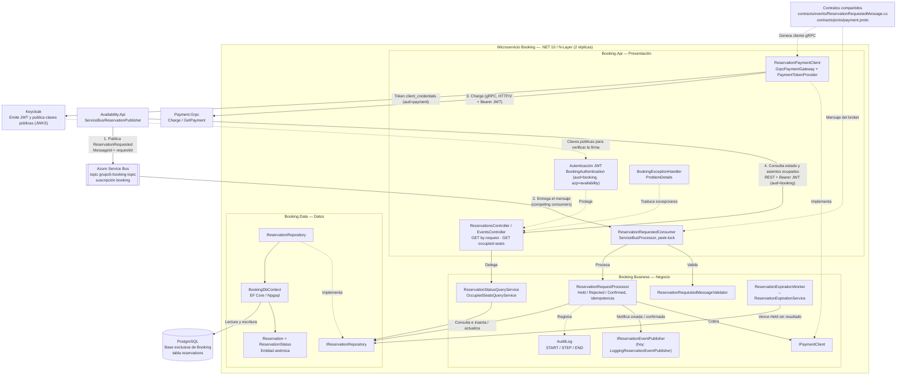

# Arquitectura de software — Microservicio Booking

**Trabajo práctico integrador:** Programación IV — UTN  
**Componente:** Booking (REST API + consumidor de Azure Service Bus)  
**Arquitectura:** N-Layer con dominio anémico  
**Referencia:** código de `feat/booking`, pruebas automatizadas (`Booking.Business.Tests`, `Booking.Api.Tests`, `Booking.Data.Tests`) y pruebas contra Azure Service Bus del 03–05/11/2026.

## 1. Diagrama de arquitectura



**Convención:** las **flechas continuas** representan invocaciones o acceso a datos. Las **flechas discontinuas** señalan implementación de interfaces, protección, registro o dependencia de contrato. No todas las flechas discontinuas son llamadas de red.

> **Aclaración sobre Keycloak:** Keycloak **emite y firma** los tokens. Booking los usa en dos sentidos: **valida** los que le manda Availability (issuer, audiencia `booking`, vencimiento, firma y `azp = availability`) y **pide** su propio token con client credentials para llamar a Payment (audiencia `payment`).

## 2. Responsabilidad de cada capa

| Capa | Componentes principales | Responsabilidad |
|---|---|---|
| **Presentación** — `Booking.Api` | `Program.cs`, `ReservationsController`, `EventsController`, `ReservationRequestedConsumer`, `BookingAuthentication`, `GrpcPaymentGateway`, `ReservationPaymentClient`, `PaymentTokenProvider`, `BookingExceptionHandler` | Exponer los endpoints REST; recibir los mensajes del broker y decidir completar, abandonar o mandar a dead-letter; adaptar la llamada gRPC a Payment; validar tokens; traducir excepciones a ProblemDetails. |
| **Negocio** — `Booking.Business` | `ReservationRequestProcessor`, `ReservationRequestedMessageValidator`, `ReservationExpirationService`, `ReservationExpirationWorker`, servicios de consulta, `IPaymentClient`, `IReservationEventPublisher`, `AuditLog` | Validar el mensaje, aplicar la idempotencia por `requestId`, retener o rechazar el asiento, interpretar el resultado del pago, vencer las reservas retenidas sin respuesta y registrar la auditoría. |
| **Datos** — `Booking.Data` | `IReservationRepository`, `ReservationRepository`, `BookingDbContext`, `ReservationConfiguration`, `Reservation`, `ReservationStatus`, migraciones | Persistir las reservas con EF Core y PostgreSQL. Los índices únicos y los `UPDATE` condicionales garantizan la concurrencia y la idempotencia en la base. |

Las entidades de Booking solo guardan datos; la lógica de negocio vive en los servicios de `Booking.Business`, en línea con el requisito de **dominio anémico**. Las interfaces `IPaymentClient` e `IReservationEventPublisher` se definen en Negocio y se implementan afuera, así Negocio no depende de gRPC ni del broker.

## 3. Flujo funcional

1. **Availability publica** `ReservationRequested` en el topic `grupo5-booking-topic` (`MessageId` y `CorrelationId` = `requestId`).
2. **Booking lo recibe** por la suscripción `booking`. Con dos réplicas, cada mensaje lo procesa una sola (competing consumers, peek-lock, `AutoCompleteMessages = false`).
3. **Validación:** si faltan ids, fecha, importe o moneda, el mensaje va a **dead-letter** sin tocar la base.
4. **Idempotencia:** si ya existe una reserva con ese `requestId`, se retoma su estado y no se cobra dos veces.
5. **Retención del asiento:** se inserta la reserva en `Held` con vencimiento (`HoldDuration`, 2 minutos). Si el asiento ya está `Held` o `Confirmed`, el índice único lo impide y se guarda `Rejected / SeatOccupied`.
6. **Cobro:** Booking llama a `Charge` en Payment con `payment_operation_id = reservation.Id`.
7. **Resultado del pago:**

   | Respuesta de Payment | Resultado en Booking |
   |---|---|
   | Pago aprobado | `Confirmed` (solo si sigue `Held` y no venció) |
   | Pago rechazado | `Rejected / PaymentFailed` |
   | Payment respondió "no disponible" | `Rejected / PaymentUnavailable` |
   | Error gRPC, timeout, `PENDING` o sin estado | **Incierto:** queda `Held`, el mensaje se abandona y se reintenta |

8. **Vencimiento:** `ReservationExpirationWorker` corre cada 30 segundos y pasa a `Expired` las reservas `Held` vencidas, lo que libera el asiento.
9. **Consulta:** Availability consulta `GET /api/reservations/by-request/{requestId}` y `GET /api/events/{eventId}/occupied-seats` con su token.
10. **Notificaciones:** al crear y al confirmar se llama a `IReservationEventPublisher`. Hoy la implementación solo registra el evento en el log; el envío real queda a cargo de Notifications.

## 4. Decisiones de diseño

| Tema | Decisión | Motivo |
|---|---|---|
| Doble reserva | Índice único parcial `(event_id, seat_id) WHERE status IN ('Held','Confirmed')` | La base decide, así funciona con varias réplicas sin locks en memoria. |
| Mensajes repetidos | Índice único por `request_id` | Service Bus entrega "al menos una vez". |
| Estados que compiten | `UPDATE ... WHERE status = 'Held' AND expires_at > @now` | El pago y el vencimiento no se pisan; no se confirma algo vencido. |
| Error de comunicación con Payment | Se trata como **incierto**, no como rechazo | Payment pudo haber cobrado: se reintenta y Payment es idempotente. |
| Mensaje inválido | Dead-letter | Reintentarlo no lo arregla y bloquearía la cola. |
| Contratos | `/contracts` compilado por ambos servicios | Availability y Booking no pueden quedar con versiones distintas del mensaje o del proto. |
| Trazabilidad | `requestId` como `CorrelationId` en logs, broker y gRPC | Se sigue una reserva de punta a punta. |

## 5. Despliegue

- Imagen: `src/Booking/Booking.Api/Dockerfile` (multi-stage, SDK → ASP.NET runtime, usuario no root). Contexto de build: raíz del repo, porque compila `/contracts`.
- `infra/docker-compose.yml`, servicio `booking-api`: **2 réplicas**, puertos 5200 y 5201, depende de `booking-db` y `keycloak`, migra la base al arrancar (`Database__MigrateOnStartup`).
- Secretos: la connection string de Azure Service Bus va en `infra/.env` (`BOOKING_BROKER_CONNECTION_STRING`), que no se commitea. El repositorio es público.

```bash
cd infra
cp .env.example .env        # completar BOOKING_BROKER_CONNECTION_STRING
docker compose up --build booking-api
```

## 6. Estado y pendientes

| Pieza | Estado |
|---|---|
| Consumidor, procesamiento, idempotencia, vencimiento | ✅ Implementado con pruebas |
| Consultas REST protegidas con JWT | ✅ Implementado con pruebas |
| Cliente gRPC a Payment | ✅ Implementado; probado contra el contrato `payment.proto` |
| Pruebas contra Azure Service Bus real | ✅ Camino feliz, 10 solicitudes al mismo asiento y timeout con reintento |
| Notificaciones reales | ⏳ Hoy solo log (`LoggingReservationEventPublisher`) |
| Pago aprobado después de vencer | ⏳ Queda en el log como caso de devolución; falta persistirlo |
