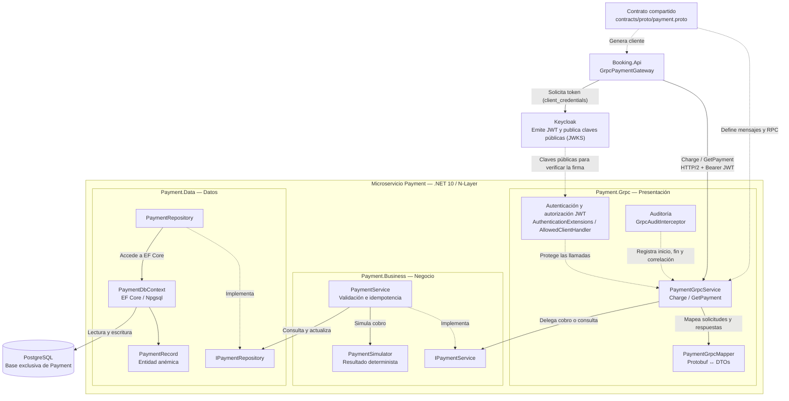

# Arquitectura de software — Microservicio Payment

**Trabajo práctico integrador:** Programación IV — UTN  
**Componente:** Payment (API gRPC)  
**Arquitectura:** N-Layer con dominio anémico  
**Responsable del componente gRPC:** Agustín Vasino  
**Estado:** **Arquitectura de Payment implementada y validada; documentación pendiente de incorporación al repositorio**  
**Referencia:** código de `feat/payment-agus`, pruebas automatizadas y verificaciones locales del 04–05/11/2026.

## 1. Diagrama de arquitectura



**Convención:** las **flechas continuas** representan invocaciones o acceso a datos. Las **flechas discontinuas** señalan relaciones de implementación, protección, configuración o dependencia de contrato. No todas las flechas discontinuas son llamadas de red.

> **Aclaración sobre Keycloak:** Keycloak **emite y firma** los tokens y publica las claves públicas. La **validación** de firma, emisor, audiencia, vencimiento y cliente autorizado la realiza `Payment.Grpc` mediante su configuración JWT de ASP.NET Core. Booking obtiene el token y lo envía como metadato `authorization` en gRPC.

## 2. Responsabilidad de cada capa

| Capa | Componentes principales | Responsabilidad |
|---|---|---|
| **Presentación** — `Payment.Grpc` | `Program.cs`, `PaymentGrpcService`, `PaymentGrpcMapper`, `AuthenticationExtensions`, `AllowedClientHandler`, `GrpcAuditInterceptor` | Exponer `Charge` y `GetPayment`; validar el formato de entrada y el token; adaptar DTOs y respuestas; traducir excepciones a códigos gRPC; registrar auditoría. |
| **Negocio** — `Payment.Business` | `IPaymentService`, `PaymentService`, `PaymentSimulator`, DTOs y excepciones | Validar reglas de negocio, controlar la idempotencia por `OperationId`, simular el resultado y coordinar las operaciones de persistencia. |
| **Datos** — `Payment.Data` | `IPaymentRepository`, `PaymentRepository`, `PaymentDbContext`, `PaymentRecord`, `PaymentStatus` | Consultar, insertar y actualizar pagos mediante EF Core y PostgreSQL. El índice único de `OperationId` impide duplicar ese identificador. |

Las entidades de Payment mantienen datos; la lógica de negocio reside en `PaymentService`, en línea con el requisito de **dominio anémico**.

## 3. Flujo funcional

1. **Booking** solicita un token a **Keycloak** mediante `client_credentials` y llama a Payment por gRPC/HTTP/2 con dicho token.
2. **Payment.Grpc** valida el JWT y autoriza al cliente `booking`. El interceptor registra el inicio, el fin y el identificador de correlación.
3. **`PaymentGrpcService`** valida los parámetros del contrato, normaliza los GUID al formato `D` (minúsculas y guiones), utiliza **`PaymentGrpcMapper`** y delega en **`IPaymentService`**. La normalización también se aplica en `GetPayment` para que variantes de mayúsculas/minúsculas identifiquen la misma operación.
4. **`PaymentService`** busca la operación por `OperationId`. Si es nueva, registra el pago inicialmente como `PENDING`; cuando corresponde, el **`PaymentSimulator`** determina el resultado.
5. **`PaymentRepository`** utiliza **`PaymentDbContext`** para persistir el estado en la base propia de Payment.
6. **`Charge`** devuelve el resultado del cobro simulado. **`GetPayment`** consulta una operación existente sin iniciar otro cobro.

## 4. Resultados y códigos de error

| Situación | Resultado |
|---|---|
| Pago simulado exitoso | `PaymentSucceeded` |
| Pago simulado rechazado | `PaymentRejected` |
| Simulador no disponible | `PaymentUnavailable` |
| Operación registrada sin resultado definitivo | `PaymentPending` |
| Mismo `OperationId` con datos diferentes | gRPC `ALREADY_EXISTS` (`PaymentConflictException`) |
| Datos de negocio inválidos | gRPC `INVALID_ARGUMENT` (`PaymentValidationException`) |
| `GetPayment` sobre una operación inexistente | gRPC `NOT_FOUND` |

**Alcance del simulador actual:** montos terminados en `99` producen rechazo; terminados en `33`, indisponibilidad; los demás, éxito. Esto es una regla de simulación para el TP, **no una pasarela de pagos real**.

## 5. Evidencia de validación local (05/11/2026)

### 5.1. Pruebas automatizadas

En `feat/payment-agus`, tras incorporar las correcciones de gRPC y las migraciones de EF Core del PR #29, se ejecutó:

```powershell
dotnet test src/Payment/Payment.Tests/Payment.Tests.csproj
```

**Resultado observado:** **77 pruebas aprobadas, 0 errores, 0 omitidas**. Se ejecutaron las pruebas con Testcontainers/PostgreSQL, incluyendo las pruebas del repositorio que aplican migraciones con `MigrateAsync()`. Las pruebas de gRPC verifican la normalización de GUID, además de validaciones, mapeo y códigos de error.

### 5.2. Migraciones y persistencia reales

- Se creó una base de pruebas independiente, `payment_migrations_test`, para no alterar la base usada previamente con `EnsureCreatedAsync()`.
- Se aplicó la migración `20261104232835_InitialCreate` mediante `dotnet ef database update --project src/Payment/Payment.Data` y se obtuvo `Done.`.
- PostgreSQL confirmó las tablas `payments` y `__EFMigrationsHistory`, la clave primaria `PK_payments` y el índice **único** `payments_operation_id_key` sobre `OperationId`.
- `Payment.Grpc` arrancó con su configuración `ConnectionStrings:Payment` apuntando a la base migrada y escuchó en `http://localhost:5300` (HTTP/2).

### 5.3. Pruebas directas del servicio gRPC

Con un cliente temporal **fuera del repositorio** y autenticación Keycloak del cliente `booking`, se verificaron:

| Escenario | Evidencia observada |
|---|---|
| `Charge` exitoso, con importe `1000` centavos | `PaymentSucceeded` |
| Simulación de indisponibilidad, con importe `1033` centavos | `PaymentUnavailable` |
| `GetPayment` de la operación creada | Mismo pago y mismo estado |
| Repetición de `Charge` con el mismo `OperationId` y los mismos datos | Mismo `PaymentId`; no crea otro pago |
| Mismo `OperationId` con datos diferentes | gRPC `AlreadyExists` |
| Operación inexistente consultada con `GetPayment` | gRPC `NotFound` |

Antes de la prueba desde Booking, la base migrada contenía un pago `SUCCEEDED` y otro `UNAVAILABLE`.

### 5.4. Integración real Azure Service Bus → Booking → Payment → PostgreSQL

Se utilizó una **copia de trabajo separada de `feat/booking`** (`git worktree`), para no mezclar el código de Booking con el PR de Payment. Se inició Booking en `http://localhost:5200`, con PostgreSQL propio, Azure Service Bus configurado y Keycloak disponible.

Los logs de Booking demostraron, para una solicitud recibida desde la suscripción compartida `grupo5-booking-topic/booking`:

1. Booking recibió y procesó una solicitud de reserva, creó la reserva y la retuvo inicialmente (`Held`).
2. Booking obtuvo correctamente un token de Keycloak (`HTTP 200`).
3. `GrpcPaymentGateway` invocó `PaymentService/Charge` por gRPC (`HTTP 200`).
4. El registro de auditoría de Booking indicó **`END Charge … Outcome=Succeeded`**.
5. La lógica de Booking finalizó con **`ProcessReservationRequest -> Confirmed`**.
6. La consulta a PostgreSQL de Payment encontró el mismo `OperationId` **`5c66adb8-33da-4bc3-8fbd-3dff1f51b835`**, persistido con estado **`SUCCEEDED`**.

Tras esa prueba, en `payment_migrations_test` había **tres registros**: **dos `SUCCEEDED` y uno `UNAVAILABLE`**. Este dato incluye los dos pagos de pruebas directas anteriores, más el cobro efectuado desde Booking.

**Alcance comprobado:** recepción del mensaje por Booking y ejecución correcta del cobro hasta la persistencia en Payment. La solicitud fue tomada de una **suscripción compartida**; la evidencia no demuestra quién la publicó ni el recorrido desde Availability.

**Limitación detectada:** los logs registraron `ReservationConfirmed` mediante `LoggingReservationEventPublisher`, con el mensaje «sin publicador real configurado». Esto **no demuestra** que Notifications haya recibido un evento o enviado una notificación.

## 6. Pendientes y límites de validación

- **Probar una caída o indisponibilidad real de Payment desde Booking**, verificando el manejo del resultado incierto, el estado de la reserva y el reintento seguro, coordinando con el equipo antes de desconectar servicios compartidos.
- **Verificar el recorrido completo desde Availability**, incluido el envío del mensaje a Azure Service Bus y la consulta posterior del estado de reserva; las comprobaciones aquí documentadas empiezan en el consumidor de Booking.
- **Implementar/verificar la publicación y el consumo reales de eventos de Notifications** para creación y confirmación de reservas. El log de eventos de Booking no sustituye una notificación real.
- **Incorporar este diagrama y el historial individual de prompts** a GitHub en un commit de documentación y cerrar la revisión del PR #27 con el equipo.
- **Completar el diagrama general, la tabla de interpretación de componentes y los diagramas de otras APIs** a nivel grupal, señalando la consistencia eventual entre Availability y Booking.

**Límites de este documento:** describe la arquitectura **de Payment** y las pruebas observadas; no certifica por sí solo la entrega completa del TP. La **consistencia eventual** y el agregado de **Notifications** deben aparecer también en el **diagrama general del sistema**.
