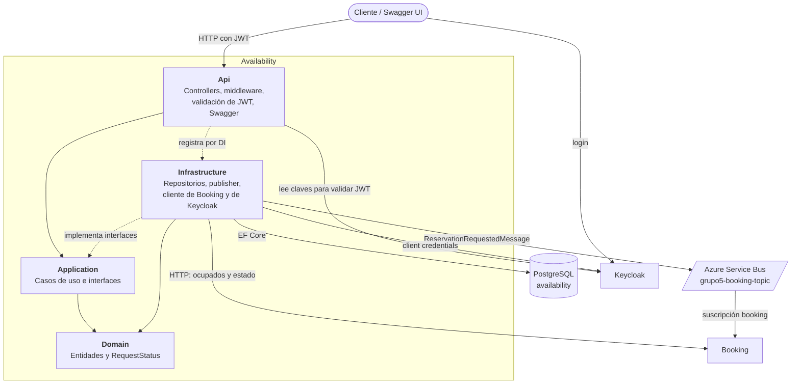

# Keycloak

Autenticación del sistema: login de usuarios con GitHub y tokens entre microservicios (client credentials).
Para la visión general del proyecto, ver el [README principal](../README.md).

## Configuración proveedor externo (GitHub)

Se debe configurar la OAuth App de GitHub (Settings > Developer settings > OAuth Apps)
De aquí se obtienen el Client y Secret.

**Homepage URL** tiene que ser:

```
http://localhost:8081
```

**Redirect URI** tiene que ser:

```
http://localhost:8081/realms/seat-reservation/broker/github/endpoint
```

## Levantar el entorno

```bash
cp infra/.env.example infra/.env
# Dentro de .env, completar los parametros GITHUB_CLIENT_ID y GITHUB_CLIENT_SECRET (Pedir por el grupo o a Feli)
# Para Availability, completar también MSG_BROKER_CONNECTION_STRING (ver sección Availability)
docker compose -f infra/docker-compose.yml up -d --build
```

- Keycloak: http://localhost:8081 (consola de admin con `KC_ADMIN` / `KC_ADMIN_PASSWORD`, realm `master`)
- Realm del TP: `seat-reservation`, importado desde `keycloak/import/seat-reservation-realm.json`

Keycloak no usa base externa: guarda todo dentro del contenedor. Al recrearlo arranca limpio y reimporta
el realm, así que los usuarios que entraron con GitHub se pierden. Para aplicar cambios del JSON:
`docker compose -f infra/docker-compose.yml up -d --force-recreate keycloak`.

## Postgres de Booking

Cada microservicio tiene su propia base PostgreSQL en su propio contenedor. El de Booking es el servicio `booking-db`:

```bash
docker compose -f infra/docker-compose.yml up -d --wait booking-db
```

- **Puerto:** se publica en `localhost:5432`. Se puede cambiar con `BOOKING_DB_PORT` en `infra/.env`;
  entre contenedores siempre es `booking-db:5432`. Cada servicio debe usar un puerto distinto del host
  (sugerido: Availability 5433, Payment 5434, Notifications 5435).
- **Credenciales:** usuario, contraseña y base valen `booking` (`BOOKING_DB_USER`, `BOOKING_DB_PASSWORD`,
  `BOOKING_DB_NAME`). Son valores de desarrollo local, no secretos.
- **Bases:** además de `booking`, la primera vez que se crea el volumen el script
  `postgres/booking/init/` crea `booking_tests`, que usan los tests de `Booking.Data.Tests`.
- **Datos:** viven en el volumen `booking-db-data` y sobreviven a `docker compose down`.
  Para empezar de cero (y que vuelva a correr el script de inicialización): `docker compose -f infra/docker-compose.yml down -v`.

Connection string desde la máquina (para `dotnet ef`, los tests y la API corriendo fuera de Docker):

```
Host=localhost;Port=5432;Database=booking;Username=booking;Password=booking
```

Para la API, guardarla en user-secrets:

```bash
dotnet user-secrets set "ConnectionStrings:Booking" "Host=localhost;Port=5432;Database=booking;Username=booking;Password=booking" --project src/Booking/Booking.Api
```

### Migraciones y tests

```bash
dotnet ef database update --project src/Booking/Booking.Data
dotnet test src/Booking/Booking.Data.Tests
```

Los tests aplican las migraciones solos sobre `booking_tests` y requieren `booking-db` levantado. Para
ejecutar el resto sin la base: `dotnet test --filter "Category!=Integration"`.

Booking ya está en el compose como `booking-api`. Su servicio usa el nombre `booking-db` (no `localhost`) y espera a que la base esté sana:

```yaml
environment:
  ConnectionStrings__Booking: Host=booking-db;Port=5432;Database=booking;Username=booking;Password=booking
  Database__MigrateOnStartup: "true"
depends_on:
  booking-db:
    condition: service_healthy
```

## Availability

Es el punto de entrada del usuario: muestra eventos y asientos, y registra las solicitudes de reserva. No decide si un asiento se reserva: publica la solicitud y Booking resuelve.

### Arquitectura

Las flechas sólidas son dependencias o llamadas; las punteadas, implementaciones y registro por inyección de dependencias.



| Proyecto         | Responsabilidad                                                                                                                                             |
| ---------------- | ----------------------------------------------------------------------------------------------------------------------------------------------------------- |
| `Domain`         | Entidades `Event`, `Seat` y `ReservationRequest`, y el enum `RequestStatus`. No depende de ningún otro proyecto.                                            |
| `Application`    | Casos de uso, interfaces que implementa Infrastructure (`IBookingClient`, `IReservationPublisher`, repositorios) y `Result`/`AppError`.                     |
| `Infrastructure` | EF Core con PostgreSQL y migraciones, publisher de Service Bus, cliente HTTP de Booking y obtención del token de Keycloak.                                  |
| `Api`            | Controllers, validación del JWT, middlewares de errores y de correlation ID, logs con Serilog y Swagger. Referencia a Infrastructure solo para registrarla. |

### Endpoints

**Swagger UI:** http://localhost:5100/swagger, disponible fuera de `Production`. Para probar los endpoints protegidos, pedir un token y pegarlo en **Authorize**, sin el prefijo `Bearer`:

```bash
curl -s http://localhost:8081/realms/seat-reservation/protocol/openid-connect/token \
  -d grant_type=password -d client_id=web -d username=tester -d password=tester
```

| Método y ruta                       | JWT | Qué hace                                                | Respuestas                        |
| ----------------------------------- | --- | ------------------------------------------------------- | --------------------------------- |
| `GET /health`                       | No  | Indica que el proceso está vivo; no revisa dependencias | `200`                             |
| `GET /api/events`                   | No  | Lista los eventos ordenados por fecha                   | `200`                             |
| `GET /api/events/{eventId}/seats`   | No  | Devuelve los asientos del evento con su estado          | `200`, `404`, `503`               |
| `POST /api/reservations`            | Sí  | Crea y publica una solicitud                            | `202`, `400`, `401`, `404`, `503` |
| `GET /api/reservations`             | Sí  | Devuelve el historial del usuario                       | `200`, `401`, `503`               |
| `GET /api/reservations/{requestId}` | Sí  | Devuelve el estado de una solicitud propia              | `200`, `401`, `403`, `404`, `503` |

El usuario se identifica con el claim `sub` del token, que debe ser un GUID. El token del usuario tiene que traer `aud=availability`.

**Crear una solicitud**

```http
POST /api/reservations
Authorization: Bearer <token>
Content-Type: application/json

{
  "eventId": "11111111-1111-1111-1111-111111111111",
  "seatId": "11111111-1111-1111-1111-111111111101"
}
```

Responde `202`, con la URL de seguimiento en el header `Location`:

```json
{
	"requestId": "a4f1b8e0-8902-4b21-9a2f-1c3d5e7f9b0a",
	"status": "PENDING",
	"message": "Solicitud de reserva aceptada. Use el requestId para seguimiento."
}
```

**Consultar el mapa de asientos**

`GET /api/events/11111111-1111-1111-1111-111111111111/seats` responde `200`. El estado de cada asiento es `AVAILABLE` u `OCCUPIED`:

```json
{
	"eventId": "11111111-1111-1111-1111-111111111111",
	"eventName": "Festival de musica",
	"totalSeats": 4,
	"availableSeats": 3,
	"seats": [
		{
			"seatId": "11111111-1111-1111-1111-111111111101",
			"label": "A1",
			"status": "OCCUPIED"
		},
		{
			"seatId": "11111111-1111-1111-1111-111111111102",
			"label": "A2",
			"status": "AVAILABLE"
		}
	]
}
```

_El ejemplo muestra solo 2 de los 4 asientos._

**Errores**

Los errores que genera la API usan este formato, y `correlationId` permite buscar la solicitud en los logs:

```json
{
	"code": "EVENT_NOT_FOUND",
	"message": "El evento especificado no existe",
	"correlationId": "26c37a22e00344d38865ca4dc4c6f38d",
	"details": null
}
```

Tres casos no lo usan, porque los resuelve ASP.NET Core antes de llegar al controller:

- **Body inválido:** `400` con `ValidationProblemDetails`.
- **Token ausente o inválido:** `401` con el cuerpo vacío.
- **GUID inválido en la ruta:** `404` con el cuerpo vacío.

Todas las respuestas incluyen el header `X-Correlation-ID`: se reutiliza el que manda el cliente o se genera uno nuevo. Un error inesperado, como una caída de la base, responde `500`.

### Estados de una solicitud de reserva

Los endpoints de `/api/reservations` usan siempre el mismo conjunto de estados:

| Estado      | Significado                                        | Quién lo decide |
| ----------- | -------------------------------------------------- | --------------- |
| `PENDING`   | Solicitud registrada; Booking todavía no la tiene  | Availability    |
| `FAILED`    | La solicitud nunca llegó a Booking                 | Availability    |
| `HELD`      | Asiento retenido mientras se procesa el pago       | Booking         |
| `CONFIRMED` | Pago aprobado, reserva confirmada                  | Booking         |
| `REJECTED`  | Reserva rechazada (asiento ocupado o pago fallido) | Booking         |
| `EXPIRED`   | La retención venció sin confirmarse                | Booking         |

Internamente, Availability guarda `Received`, `Published` o `PublishFailed` (`RequestStatus`). Esos valores no salen por la API: la traducción está en `Availability.Application/Common/RequestStatusResolver.cs`.

**Qué devuelve cada endpoint**

- `POST /api/reservations`: `PENDING` (`202`). Si la publicación en Service Bus falla, responde `503` y la solicitud queda `FAILED`.
- `GET /api/reservations/{requestId}`: el estado completo, más `description`, que puede ser `null`. Para `REJECTED`, la `description` explica el motivo (por ejemplo, `"El asiento está ocupado."`). Salvo que la publicación haya fallado, siempre se consulta primero a Booking, así que el estado se actualiza solo cuando Booking procesa el mensaje; si no se puede consultar a Booking, responde `503`. `updatedAt` hoy siempre coincide con `createdAt`, porque Availability no actualiza esa columna al cambiar el estado.
- `GET /api/reservations`: historial del usuario, con el mismo estado que el endpoint anterior pero sin `description`. Hace una consulta a Booking por cada solicitud cuya publicación no haya fallado; si alguna de esas consultas no se puede completar, responde `503`.

**Solicitudes que no llegaron a publicarse**

El `POST` guarda la solicitud como `Received`, la publica y después la marca `Published` (o `PublishFailed`). Si el proceso se cae entre esos pasos, queda en `Received` y hay dos casos:

- **El mensaje llegó a salir:** Booking lo procesa y el `GET` por `requestId` muestra su estado.
- **El mensaje no salió:** Booking nunca la va a tener. Si Booking responde `404` y pasaron más de 5 minutos desde la creación, el `GET` por `requestId` devuelve `FAILED` con `"La solicitud no llegó a publicarse"`.

La regla se aplica al leer: no modifica la base ni reenvía la solicitud, porque el usuario ya recibió un error en el `POST` y reservarle el asiento después lo confundiría. Para reintentar, se crea una solicitud nueva.

### Mensaje publicado en Azure Service Bus

Cada solicitud publica un `ReservationRequestedMessage` ([`contracts/events`](contracts/events/ReservationRequestedMessage.cs)) en el topic `grupo5-booking-topic`. Booking lo consume con la suscripción `booking`.

```json
{
	"requestId": "a4f1b8e0-8902-4b21-9a2f-1c3d5e7f9b0a",
	"eventId": "11111111-1111-1111-1111-111111111111",
	"seatId": "11111111-1111-1111-1111-111111111101",
	"userId": "7c1e4d2a-5b3f-4a6e-9d8c-0f1a2b3c4d5e",
	"requestedAt": "2026-11-05T23:45:25.161561+00:00",
	"amountCents": 15000,
	"currency": "ARS"
}
```

- `MessageId` y `CorrelationId` del mensaje son el `requestId`.
- `amountCents` y `currency` salen del evento guardado en Availability.

### Dónde el sistema es eventualmente consistente

Availability no reserva asientos: la decisión final la toma Booking, de forma asincrónica. Por eso:

- **El `202` no garantiza el asiento.** El `POST` solo comprueba que el asiento exista en ese evento, no que esté libre. Si está ocupado, la API igual responde `202` y Booking la rechaza después (`REJECTED`).
- **El mapa de asientos es una foto del momento.** Un asiento `AVAILABLE` puede ocuparse antes de que llegue la solicitud.
- **Se pueden crear solicitudes repetidas.** Dos `POST` por el mismo asiento generan dos `requestId` distintos, incluso del mismo usuario, y Booking resuelve cada una.
- **Al principio, el estado puede ser `PENDING`.** Booking responde `404` hasta procesar el mensaje, y mientras tanto la API devuelve `PENDING`.

### Cuando falta un componente

| Componente caído | Efecto en la API, con el proceso ya corriendo                                                                                                                      | Al arrancar                                        |
| ---------------- | ------------------------------------------------------------------------------------------------------------------------------------------------------------------ | -------------------------------------------------- |
| Booking          | `seats`, `GET /api/reservations` y `GET /api/reservations/{requestId}` responden `503`, salvo que no haga falta consultar a Booking porque la publicación falló (o el historial está vacío). El `POST` y los eventos siguen funcionando. | Arranca igual                                      |
| Service Bus      | El `POST` responde `503` y la solicitud queda `FAILED`. El resto sigue funcionando.                                                                                | Arranca igual si la connection string está cargada |
| PostgreSQL       | Los endpoints que usan la base responden `500`. `/health` sigue en `200`, porque no revisa dependencias.                                                           | No arranca: aplica las migraciones al iniciar      |
| Keycloak         | Los endpoints protegidos responden `401`; `seats` responde `500`, porque no se puede pedir el token para Booking. `GET /api/events` sigue funcionando.             | Arranca igual                                      |

Las llamadas HTTP a Booking y Keycloak usan el handler de resiliencia estándar de .NET, con reintentos, y el cliente de Service Bus usa su política de reintentos por defecto. Por eso, estas respuestas pueden demorar unos segundos.

### Configuración y datos de prueba

**Configuración:** las claves necesarias, los secretos y cómo levantar la API dentro y fuera de Docker están en [`infra/README.md`](infra/README.md#availability). Si falta alguna clave obligatoria, la API no arranca y el log indica cuál es.

**Datos de prueba:** las migraciones cargan estos eventos, cada uno con los asientos `A1`, `A2`, `B1` y `B2`:

| Evento                      | `eventId`                              | Fecha (UTC)        | Precio     | `seatId` de `A1`, `A2`, `B1` y `B2`                |
| --------------------------- | -------------------------------------- | ------------------ | ---------- | -------------------------------------------------- |
| `Festival de musica`        | `11111111-1111-1111-1111-111111111111` | `2026-12-01 20:00` | 150,00 ARS | `11111111-1111-1111-1111-1111111111` + `01` a `04` |
| `Conferencia de tecnologia` | `22222222-2222-2222-2222-222222222222` | `2027-01-15 18:30` | 200,00 ARS | `22222222-2222-2222-2222-2222222222` + `01` a `04` |

**Tests:** `Availability.Infrastructure.Tests` cubre los repositorios, el publisher y los clientes de Booking y Keycloak. Los tests de repositorios necesitan Docker. Application y Api no tienen tests automatizados.

```bash
dotnet test src/Availability/Availability.Infrastructure.Tests
```

**Documentación de diseño:** las reglas de negocio y las decisiones técnicas están en [`Availability.Infrastructure/specs`](src/Availability/Availability.Infrastructure/specs).

## Postgres de Payment

La base de Payment es el servicio `payment-db`. Como el resto, es una base propia en su propio contenedor:
ningún otro servicio la lee.

```bash
docker compose -f infra/docker-compose.yml up -d --wait payment-db
```

- **Puerto:** se publica en `localhost:5434`. Se puede cambiar con `PAYMENT_DB_PORT` en `infra/.env`;
  entre contenedores siempre es `payment-db:5432`.
- **Credenciales:** usuario, contraseña y base valen `payment` (`PAYMENT_DB_USER`, `PAYMENT_DB_PASSWORD`,
  `PAYMENT_DB_NAME`). Son valores de desarrollo local, no secretos.
- **Datos:** viven en el volumen `payment-db-data` y sobreviven a `docker compose down`.
  Para empezar de cero: `docker compose -f infra/docker-compose.yml down -v`.

Connection string desde la máquina (para `dotnet ef` y para la API corriendo fuera de Docker):

```
Host=localhost;Port=5434;Database=payment;Username=payment;Password=payment
```

Payment.Grpc la lee de la clave `ConnectionStrings:Payment`. Para guardarla en user-secrets:

```bash
dotnet user-secrets set "ConnectionStrings:Payment" "Host=localhost;Port=5434;Database=payment;Username=payment;Password=payment" --project src/Payment/Payment.Grpc
```

Si el comando avisa que falta el `UserSecretsId`, correr antes
`dotnet user-secrets init --project src/Payment/Payment.Grpc`.

### Migraciones

`dotnet ef` toma la cadena de la variable de entorno `PAYMENT_DB_CONNECTION_STRING` (si falta, falla con un mensaje claro):

```powershell
# PowerShell
$env:PAYMENT_DB_CONNECTION_STRING = "Host=localhost;Port=5434;Database=payment;Username=payment;Password=payment"
```

```bash
# Bash
export PAYMENT_DB_CONNECTION_STRING="Host=localhost;Port=5434;Database=payment;Username=payment;Password=payment"
```

```bash
dotnet ef database update --project src/Payment/Payment.Data
```

La base debe ser nueva o tener ya el historial de migraciones. Más detalle en
[`src/Payment/Payment.Data/README.md`](../src/Payment/Payment.Data/README.md).

### Tests

```bash
dotnet test src/Payment/Payment.Tests
```

Las pruebas de integración del repositorio levantan su propio PostgreSQL temporal con Testcontainers:
solo necesitan Docker en ejecución, no `payment-db`.

### Secrets

- `PAYMENT_CLIENT_SECRET` (en `infra/.env`, por defecto `payment-secret`) es el secret del client `payment` en Keycloak.
- Payment valida los tokens que recibe: `aud=payment` y solo acepta llamadas del client `booking`.
  Quien llama a Payment (Booking) usa su propio secret, `BOOKING_CLIENT_SECRET`.

### Payment API

Payment ya está en el compose como `payment-api`:

```bash
docker compose -f infra/docker-compose.yml up -d --build payment-api
```

- **Puerto:** `localhost:5300` (configurable con `PAYMENT_API_PORT`). Dentro de Docker escucha en `8080`.
- **Base:** usa `payment-db:5432`; al arrancar aplica las migraciones porque el compose define
  `Database__MigrateOnStartup=true`.
- **Keycloak:** valida el issuer público `http://localhost:8081/realms/seat-reservation` y descarga
  la metadata por `http://keycloak:8081/...`.
- **Health:** el endpoint `/health` comparte el puerto gRPC y solo habla HTTP/2:

```bash
curl --http2-prior-knowledge http://localhost:5300/health
```

La configuración equivalente del servicio es:

```yaml
environment:
  ConnectionStrings__Payment: Host=payment-db;Port=5432;Database=payment;Username=payment;Password=payment
  Database__MigrateOnStartup: "true"
  Keycloak__Authority: http://localhost:8081/realms/seat-reservation
  Keycloak__MetadataAddress: http://keycloak:8081/realms/seat-reservation/.well-known/openid-configuration
  Keycloak__RequireHttpsMetadata: "false"
depends_on:
  payment-db:
    condition: service_healthy
  keycloak:
    condition: service_healthy
```

Booking apunta a `http://payment-api:8080` por defecto. Si ejecutás Payment con `dotnet run`, cambiá
`BOOKING_PAYMENT_ADDRESS` a `http://host.docker.internal:5300` en `infra/.env`.

## Login con GitHub

La pantalla de login muestra un botón por cada identity provider habilitado (por ahora, GitHub).
El registro con usuario y contraseña está deshabilitado: el formulario solo sirve para el usuario de prueba.
Para probar: http://localhost:8081/realms/seat-reservation/account

## Clients

| Client          | Tipo               | Para qué                  | `aud` del token |
| --------------- | ------------------ | ------------------------- | --------------- |
| `web`           | público, PKCE      | login del usuario final   | `availability`  |
| `availability`  | client credentials | llamar a Booking por HTTP | `booking`       |
| `booking`       | client credentials | llamar a Payment por gRPC | `payment`       |
| `payment`       | client credentials | —                         | —               |
| `notifications` | client credentials | —                         | —               |

Todos los usuarios nuevos (incluidos los de GitHub) reciben el rol de realm `user`.

## Pedir un token

Servicio a servicio (client credentials):

```bash
curl -s http://localhost:8081/realms/seat-reservation/protocol/openid-connect/token \
  -d grant_type=client_credentials -d client_id=availability -d client_secret=availability-secret
```

Usuario de prueba, sin navegador (solo para scripts y tests):

```bash
curl -s http://localhost:8081/realms/seat-reservation/protocol/openid-connect/token \
  -d grant_type=password -d client_id=web -d username=tester -d password=tester
```

## Validar el JWT desde un servicio

- Issuer: `http://localhost:8081/realms/seat-reservation` (siempre el mismo, incluso dentro de Docker).
- Desde un contenedor, la metadata está en
  `http://keycloak:8081/realms/seat-reservation/.well-known/openid-configuration`.
- Audience: el `clientId` del servicio que recibe la llamada (por ejemplo, Booking valida `aud=booking`).

Booking ya está en el compose (`booking-api`) con estas variables en su servicio:

```yaml
environment:
  Authentication__Authority: http://localhost:8081/realms/seat-reservation
  Authentication__MetadataAddress: http://keycloak:8081/realms/seat-reservation/.well-known/openid-configuration
  Authentication__RequireHttpsMetadata: "false"
```

`Authority` conserva el issuer de los tokens; `MetadataAddress` usa el nombre accesible
desde la red de Docker. El Keycloak del compose ya habilita el backchannel dinámico
para publicar también una dirección interna de las claves de firma (`jwks_uri`).
Permitir metadata por HTTP es una configuración explícita del entorno local del TP.
Fuera de Development, Booking exige HTTPS por defecto y mantiene la validación de
issuer, audiencia, vencimiento y firma. El compose actual levanta Keycloak, las bases de Booking, Availability y Payment, y las APIs `booking-api`, `availability-api` y `payment-api`.

Availability valida `aud=availability`. Dentro de Docker usa `JwtSettings:Authority=http://keycloak:8081/realms/seat-reservation`
para leer la metadata; en local, `http://localhost:8081/realms/seat-reservation`.
